### Hi, I'm Azwan 👋

Data engineer in Malaysia. I build pipelines on AWS, Azure, Databricks, and more, and tools that connect data to LLMs over MCP.

  

  
  
  
  

**Projects**

- [electiondata_mcp](https://github.com/azwanzuharimi/electiondata_mcp): MCP server for Malaysian election data from ElectionData.MY
- [omp-claudecode-port-project](https://github.com/azwanzuharimi/omp-claudecode-port-project): context-saving tricks from oh-my-pi, ported to Claude Code with hooks and skills

  
  

